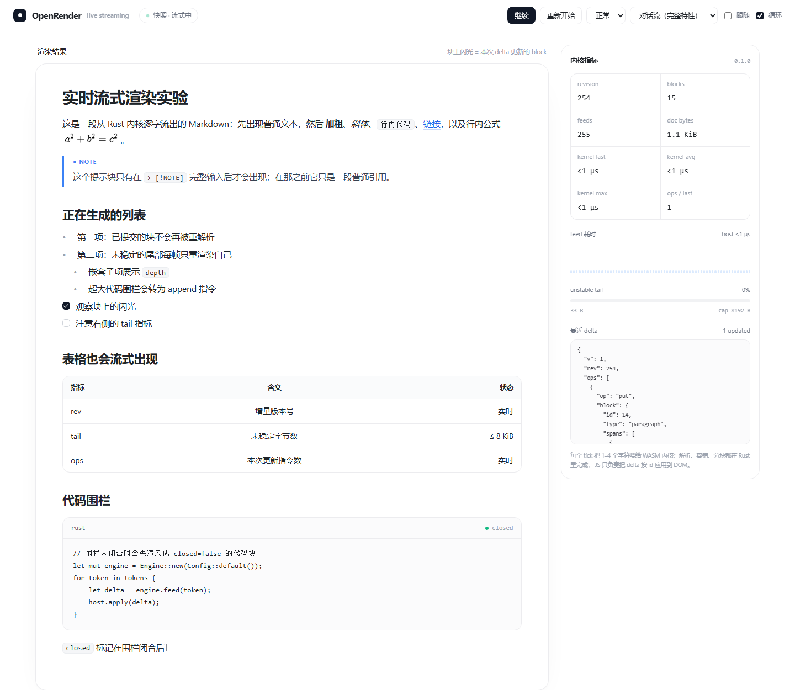

# OpenRender

[English](README.EN.md) | **简体中文**

**流式优先的 Rust Markdown 引擎。** 逐 token 喂入文本，持续输出带稳定 `block_id` 的语言无关渲染指令。无 WebView、无 JavaScript 运行时、无 GUI 工具包——原生解析器加宿主自绘的渲染层。

[](LICENSE)
[](https://www.rust-lang.org)
[](#构建)
[](#路线图)


*浏览器预览页的真实截图：Rust 引擎产出的 22 个 IR 块，由轻量宿主渲染器绘制。页面源码：[`preview/index.html`](preview/index.html) · 生成器：[`examples/preview.rs`](crates/openrender-core/examples/preview.rs)。*

---

## 为什么需要 OpenRender

流式聊天、实时笔记、AI 输出面板和终端 UI 都面临同一个问题：Markdown 是碎片化到达的，而常见做法是每来一个片段就重解析整篇文档。这是 O(N²)，移动端会掉帧，还会把宿主逼进一个几十 MB、执行 JavaScript、且无法把结构化数据交回原生代码的 WebView。

OpenRender 换了一条路：

1. **只提交不会再变化的内容。** 已稳定的块只解析一次并缓存。
2. **只重解析尾部。** 单次调用成本 = 新增文本 + 固定尾部窗口。
3. **返回指令，而不是像素。** 排版、媒体播放、卡片和手势由宿主决定。

结果是一个约 500 KiB 的原生库，让 1 MB 文档保持交互级流式渲染，同时有确定的内存上限与 C ABI / JNI 接口。

---

## 设计原则

| 原则 | 结果 |
|---|---|
| **线性流式** | 每次 `feed` 成本为 O(新增文本 + `max_tail_bytes`)，绝不随整篇文档增长。 |
| **内存有界** | 尾部上限、文档上限、块数上限；超大代码围栏用 `append` 流式追加，不整块重发。 |
| **稳定标识** | 每个块带稠密、递增的 `block_id`；UI 按 id 做 diff。 |
| **宿主自绘** | 引擎从不加载图片、播放音频或绘制文字，只输出 URL、尺寸与语义。 |
| **默认安全** | URL scheme 白名单、不执行 HTML、FFI 捕获 panic、迭代式解析（无栈递归）。 |
| **接口面小** | 只有一个解析依赖（`pulldown-cmark`）；手写 JSON 编码；其余能力均为可选特性。 |

---

## 架构

```text
feed(text)
   │  追加到节流缓冲（合并突发调用）
   ▼
held 尾部  ──►  提交点扫描
   │               空行 · 闭合围栏 · ATX 标题 · 分隔线
   ├── 已稳定分片 ──► pulldown-cmark ──► IR 块 ──► delta { put }
   └── 未稳定尾部 ──► 补齐未闭合标记 ──► 重新渲染 ──► delta { put }
```

**提交点是保守的。** 普通段落行*不是*提交点：后一行是 `---` 会把它变成 setext 标题，是表格分隔行会把它变成表头。只有含义不会被后续输入改写的位置才会被提交。

**超大尾部会被切分。** 未稳定尾部超过 `max_tail_bytes`（默认 8 KiB）时，会在行/词边界强制提交。这是唯一可能让一个段落变成两个块的场景。

**超大代码围栏走 spill。** 打开的围栏超过上限后，已完整的行以 `append` 指令追加到已提交的代码块；闭合围栏时发 `close`。流式成本与新增行数成正比，而不是与整个围栏成正比。

**容错。** 渲染尾部前，未闭合的围栏、行内代码、`$…$`、`**`、`*`、`_`、`~~` 会用最小标记补全。被截断的流仍能像已完成一样渲染（`closed: false` 表示合成闭合）。

**摊还复杂度。** 每个字节在稳定时解析一次，在尾部期间解析有限次。总成本随文档大小线性增长，常数由尾部上限决定。

---

## 30 秒了解 IR

一次调用返回一个 delta，指令按 `block_id` 应用：

```json
{
  "v": 1,
  "rev": 7,
  "ops": [
    { "op": "put",    "block": { "id": 3, "type": "paragraph", "spans": [
        { "type": "text", "text": "Hello " },
        { "type": "text", "text": "world", "bold": true },
        { "type": "latex_inline", "tex": "E=mc^2" }
    ]}},
    { "op": "append", "id": 4, "text": "more code\n" },
    { "op": "close",  "id": 4 },
    { "op": "remove", "id": 9 }
  ]
}
```

| 指令 | 含义 |
|---|---|
| `put` | 插入或替换一个块。块仍处于未稳定尾部时会重复下发。 |
| `append` | 向流式代码块追加文本（超大围栏）。 |
| `close` | 代码块收到了闭合围栏。 |
| `remove` | 尾部收缩，某个块消失。 |

**块类型：** `paragraph`、`heading`（`level`）、`code_block`（`lang`、`text`、`closed`）、`list_item`（`depth`、`marker`、`checked`）、`table`（`align`/`header`/`rows`）、`rule`、`footnote_def`、`latex_block`（`tex`，可选 PNG）、`audio`（`url`、`title`）、`link_preview`（`url`、`title`、`description`）。

**行内 span：** `text`（`bold`/`italic`/`strike`/`url`/`title`）、`code`、`image`（`src`/`alt`/`width`/`height`）、`audio`、`latex_inline`（`tex`，可选 PNG）、`footnote_ref`、`softbreak`、`hardbreak`。

样式被展平为布尔字段，宿主一次遍历即可构建 attributed string。id 按文档顺序从 0 开始稠密分配；已稳定的 id 永不变。

---

## 支持的 Markdown

| 范围 | 支持 |
|---|---|
| CommonMark | 标题、段落、有序/无序/嵌套列表、引用、围栏与缩进代码、行内代码、加粗、斜体、链接、图片、分隔线 |
| GFM | 带对齐的表格、任务列表、删除线、GFM 警告块（`NOTE` / `TIP` / `IMPORTANT` / `WARNING` / `CAUTION`） |
| 扩展 | 脚注、行内 `$…$` 与块级 `$$…$$` 数学、智能标点（可选） |
| 媒体 | 音频 URL（`mp3`、`wav`、`m4a`、`aac`、`ogg`、`opus`、`flac`、`weba`、`3gp`、`amr`，可配置）转为 `audio` 块/span |
| 链接 | 自定义 scheme（如 `agent://resource/42`）、尺寸提示（`=640x360`）、配置域名下的链接预览卡 |
| LaTeX | 始终导出 TeX 源码；可选 RaTeX（纯 Rust、KaTeX 兼容）渲染带内嵌字体的 PNG |

HTML 永不执行。默认按字面文本保留；`drop_html` 可完全丢弃。

---

## 量化结果

**环境：** Intel Core i7-12700H（14C/20T）、16 GB 内存、Windows x86_64、Rust 1.99.1；`--release`，`opt-level = 3`、fat LTO、`codegen-units = 1`、`strip = "symbols"`。在空闲机器上取 4 次一次性样本与 2 次流式样本的中位数，使用仓库自带基准：

```bash
cargo run --release -p openrender-core --example bench
```

两套合成的 1 MB 语料：

- **Prose** —— 标题、长段落、强调、链接、行内代码、少量列表。10,068 个块，最接近聊天/LLM 输出。
- **Dense** —— 重复的“表格 + 引用 + 任务列表”小节。每 MB 36,150 个块（约每块 28 字节），是对块管理最严苛的压力场景。

| 语料 | 渲染 | JSON 序列化 | 4 KiB 分片流式（含 JSON） | 解析吞吐 |
|---|---:|---:|---:|---:|
| Prose（1 MB） | **12.1 ms** | **2.7 ms** | **13.8 ms** | 65–90 MB/s |
| Dense（1 MB） | **50.7 ms** | **7.3 ms** | **70 ms** | 14–22 MB/s |

- 流式数字包含每个 delta 的 JSON 序列化，即 C/JNI 宿主的完整路径。
- JSON 体积：Prose 文档 2.4 MB，Dense 文档 6.5 MB——宿主侧的重要预算项。
- 整个基准进程（两套 1 MB 语料、块表与 JSON 字符串）的峰值工作集：**69.6 MiB**。
- `feed` 成本为 O(新增文本 + ≤ 8 KiB 尾部)；`finish` 只渲染剩余尾部一次。任何调用都不会全量重解析。
- 这里**不宣称** ARM64 设备数据。单核性能预计比该笔记本慢约 2–3 倍；Prose 语料对 200 ms 预算余量充足，Dense 语料则刻意贴近上限。

### 二进制体积（Windows x64，release，已 strip）

| 构建 | `openrender.dll` |
|---|---:|
| 默认（解析 + IR + C ABI） | **494 KiB** |
| `--features jni` | **521 KiB** |
| `--features latex` | **499 KiB** |
| staticlib（`openrender.lib`，含 Rust `std`） | **15.5 MiB** |

`ratex` 为可选特性，未列入表中：它内嵌 KaTeX 字体，仅面向需要离线 PNG 公式的宿主。Android `.so` 体积会与 Windows 不同，但核心构建仍处于同一数量级。实时演示使用的 `wasm32-unknown-unknown` 核心为 **301 KiB**。

---

## 配置

所有开关均可从 Rust 与 C ABI 设置；Kotlin 封装暴露常用子集（构造函数 + `configure()`）：

| 配置 | 默认 | 作用 |
|---|---|---|
| `throttle_ms` | `8` | 两次解析之间的最小间隔；`0` = 来就渲染。 |
| `max_tail_bytes` | `8192` | 限制单次重解析与强制切分行为。 |
| `max_document_bytes` | `16 MiB` | 输入硬上限；超出部分丢弃。 |
| `max_blocks` | `1,000,000` | 块数硬上限；`0` 表示不限。 |
| `parser_flags` | `0x3F` | 表格、删除线、任务列表、脚注、GFM 警告、数学。 |
| `enable_previews` + `preview_domains` | 关 / 空 | 将独立链接转为预览卡。 |
| `soft_break_as_space` | 关 | 软换行输出为空格，而非 `softbreak` span。 |
| `drop_html` | 关 | 丢弃原始 HTML，而非按字面文本输出。 |
| `enable_size_hints` | 开 | 识别 `=640x360` 这类图片尺寸提示。 |
| `audio_extensions` | mp3/wav/m4a/… | 追加识别为音频指令的扩展名。 |
| `allowed_schemes` | http, https, file, mailto, tel | 其余 scheme 一律降级为纯文本。 |

引擎是同步的：解析发生在调用线程的 `feed`/`flush`/`finish` 内。没有定时器，也没有后台线程；需要按帧输出的宿主可在渲染循环里调用 `flush()`。

---

## 用法

### Rust

```rust
use openrender::{Config, Engine};

let mut engine = Engine::new(Config::default());
for chunk in ["# Title\n\n", "Streaming **bold", "** text.\n"] {
    println!("{}", engine.feed(chunk).to_json());
}
println!("{}", engine.finish().to_json());
```

一次性渲染：`Engine::render_once(markdown, &config).to_json()`。

### C

```c
#include "engine.h"

OrEngine *engine = or_engine_new(NULL);
char *delta = or_engine_feed(engine, text, len);
or_string_free(delta);
char *done = or_engine_finish(engine);
or_string_free(done);
or_engine_free(engine);
```

完整示例：[`examples/c/demo.c`](examples/c/demo.c)。头文件：[`include/engine.h`](include/engine.h)（由 cbindgen 生成）。

### Kotlin / Android

```kotlin
val engine = NativeEngine()
val applier = DeltaApplier()

engine.feed("# Hello\n\nwor").let(applier::apply)
engine.feed("ld\n\n").let(applier::apply)
engine.finish().let(applier::apply)

adapter.submitList(applier.snapshot())
engine.close()
```

[`NativeEngine.kt`](android/app/src/main/java/ai/openrender/NativeEngine.kt) 包含 JNI 封装、`DeltaApplier`（`put`/`append`/`close`/`remove`）与解析器位常量。

### 可选公式渲染

```c
// 宿主通过 C ABI 注入渲染器：
or_engine_set_math_renderer(engine, render_math, free_math, NULL);

// 或使用内置纯 Rust RaTeX（编译时 --features ratex）：
or_engine_use_ratex(engine, 40.0f, 2.0f);
```

不注入渲染器时，公式以 TeX 源码保留在 IR 中，由宿主自行排版。

---

## 构建

### 桌面

```bash
cargo test --workspace
cargo run --release -p openrender-core --example bench
cargo run -p openrender-core --example stream
```

### C 头文件

```bash
cargo install cbindgen
cbindgen --config cbindgen.toml --crate openrender-core --output include/engine.h
```

### Android

```bash
rustup target add aarch64-linux-android armv7-linux-androideabi x86_64-linux-android
cargo install cargo-ndk
export ANDROID_NDK_HOME=/path/to/ndk

./scripts/build-android.sh --jni --latex
# Windows：
./scripts/build-android.ps1 -WithJni -WithLatex
```

每个 ABI（`arm64-v8a`、`armeabi-v7a`、`x86_64`）输出：

```text
android/jniLibs/<abi>/libopenrender.so
android/jniLibs/static/<abi>/libopenrender.a
```

### Gradle

[`android/openrender.gradle.kts`](android/openrender.gradle.kts) 注册 `cargo ndk` 任务，并接入 `mergeJniLibFolders`/`preBuild`，新构建的 `.so` 会直接进 APK，无需手动拷贝。

### 实时流式演示（WASM）

`web/` 是自包含的实时演示：同一份 Rust 核心编译到 `wasm32-unknown-unknown`，每个 tick 喂入 1–4 个字符，所有 delta 都按 `block_id` 应用到 DOM。

| 流式中（尾部仍在增长） | 完成态 |
|---|---|
|  |  |

<video src="https://raw.githubusercontent.com/raine-x/OpenRender/main/web/demo.mp4" controls muted loop playsinline></video>

*实时演示录屏：逐字符喂入、DOM 增量更新、右侧内核指标实时变化。原始文件：[`web/demo.mp4`](web/demo.mp4)。*

```bash
rustup target add wasm32-unknown-unknown
cargo build -p openrender-core --target wasm32-unknown-unknown --release --features ratex
cp target/wasm32-unknown-unknown/release/openrender.wasm web/engine.wasm
python -m http.server 8124 --directory web
# 打开 http://127.0.0.1:8124/
```

不含数学的核心 wasm 为 **301 KiB**；演示构建启用 `--features ratex`，内嵌 KaTeX 字体，体积 **4.4 MiB**。它导出同一套 C ABI（`or_engine_*`），并额外提供 `or_alloc`/`or_free_buffer` 以便零胶水拷贝字符串。指标面板展示每次 feed 的内核耗时、op 数、未稳定尾部字节数、revision 和最近一次 delta。

### 预览页

```bash
cargo run -p openrender-core --features ratex --example preview -- preview/delta.json
python -m http.server 8123 --directory preview
# 打开 http://127.0.0.1:8123/
```

页面拉取 IR delta，并用一个独立的小型宿主渲染器绘制。

---

## 验证

| 检查项 | 结果 |
|---|---|
| 单元 + 集成测试 | 13 + 20，全部通过 |
| 文档测试 | 通过 |
| 特性构建 | `latex`、`jni`、`ratex` 均可编译 |
| RaTeX 渲染测试 | 带内嵌字体的真实 PNG 输出 |
| C ABI | `examples/c/demo.c` 用 MSVC 编译并成功运行于 `openrender.dll` |
| WASM 演示 | 已构建 `wasm32-unknown-unknown`，并实际运行流式与截图 |
| JNI 导出 | 二进制中确认存在 `Java_ai_openrender_NativeEngine_*` 与 `or_engine_*` |
| 格式化 | `cargo fmt --check` 通过 |

```bash
cargo test --workspace
cargo test -p openrender-latex --features ratex
cargo build -p openrender-core --features jni
```

Android 交叉编译已脚本化，但需要 NDK；本仓库的测试环境未执行。

---

## 安全模型

- **导航白名单。** 仅保留配置过的 scheme（`http`、`https`、`file`、`mailto`、`tel` 及宿主追加项）。`javascript:`、`data:` 与未知 scheme 一律降级为文本；被拒绝 scheme 的图片降级为 alt 文本。
- **不执行代码。** HTML 只是数据，不是标记；没有 WebView、没有 JS 引擎，引擎也不访问网络。
- **资源上限。** 文档字节数、块数和未稳定尾部大小均有上限；解析器与 IR 构建器都是迭代式的，嵌套深度不会撑爆原生栈。
- **FFI 不 panic。** 所有导出函数捕获 panic，返回 `{"error": ...}`，绝不让异常跨越边界展开。
- **所有权明确。** 字符串以堆上的 `char *` 返回，必须用 `or_string_free` 释放；回调在 `free` 前由引擎拷贝媒体字节。

---

## 已知取舍

1. **列表会在空行处拆分。** 列表项之间有空行时，该列表会在空行处提交；有序编号按源文本保留，但 UI 可能显示成两个列表块。
2. **超长单段** 超过 `max_tail_bytes` 后会在词边界强制切分。
3. **Spill 延迟。** 超过 8 KiB 的超大代码围栏，其“正在输入的最后一行”要等下一个换行才显示。
4. **复杂容器**（表格、深层引用）在极端流式切分下可能先以更简单的块出现，稳定后再用 `put` 替换；id 保持不变。
5. **暂无 video 块。** 音频有独立指令；视频 URL 目前回退为图片/链接语义。
6. **脚注引用需要与定义在同一解析窗口。** 如果引用先稳定、定义后到，引用会保持字面量 `[^n]`，不会变成脚注 span。请让引用与定义在流中相邻（演示页即如此），或使用一次性渲染。
7. **JSON 偏冗长。** IR 有意保持人类可读；二进制编码在路线图中。

---

## 路线图

- 与现有 op 模型兼容的二进制 IR 编码。
- `video` 块/span 与封面图支持。
- 设备基准矩阵（ARM64、低端 Android、iOS）。
- 针对流式不变量的 fuzzing 与属性测试。
- 行内 checkpoint，降低病态单段落的尾部重解析成本。
- Swift / UniFFI 绑定。

---

## 贡献

欢迎 Issue 与 PR。当前最有价值的贡献：

- **真机基准数据**（SoC、Android 版本、语料、`feed` 大小）以 Issue 形式提交。
- **对抗性 Markdown 语料**，能击穿渲染或流式不变量。
- **宿主渲染器**（Jetpack Compose、UIKit、终端）来检验 IR。

请保持核心除 `pulldown-cmark` 外无额外依赖，并为每个行为变更补测试。提交 PR 前运行 `cargo fmt` 与 `cargo test --workspace`。

---

## 许可证

MIT。见 [LICENSE](LICENSE)。

---

## 为什么这件事重要

富文本不应依赖浏览器内核、网络连接或旗舰手机。OpenRender 是一个小、确定、保护隐私的核心，让任何原生界面——聊天应用、笔记编辑器、终端、离线知识库——都能在设备本地增量渲染 Markdown，无遥测、无 JavaScript。这就是它的贡献：把足够好的文本渲染能力，交到每一块屏幕手里，包括那些不起眼的屏幕。
